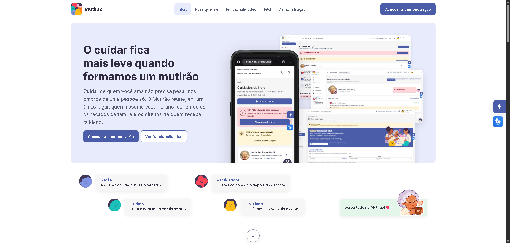

<div align="center">
  
  <h1>Mutirão</h1>
  <h3>O cuidar fica mais leve quando formamos um mutirão.</h3>
  <p><b>Global Solution 2026 · Citizen Tech · Web Design FIAP</b></p>
  <p>Mutirão conecta familiares e cuidadores para organizar a rotina, dividir responsabilidades e passar adiante o que aconteceu no cuidado compartilhado.</p>
  <p>
    <a href="https://mutirao-ctrlpeople-citizen-tech-26.vercel.app/">Acessar o Mutirão</a> ·
    <a href="https://mutirao-pontobot-frontend.vercel.app/">PontoBOT (Assistente)</a> ·
    <a href="https://github.com/mewmewdevart/PontoBOT">Repositório PontoBOT</a>
  </p>
  <p>
    
    
    
  </p>
</div>

<br>

> [!TIP]
> **Protótipo navegável com dados fictícios:** clique em **Acessar a demonstração** na página inicial, entre com o acesso já preenchido e use o seletor **Quem recebe cuidado** no topo para alternar do **Flavinho** para a **Mari** e testar a escala 24h, o porta-remédios e o Diário de turno.

## 📌 Resumo do Projeto

O **Mutirão** é um protótipo desenvolvido para a **Global Solution 2026 da FIAP**, no desafio **Citizen Tech** (equipe **Ctrl + People**). O projeto nasce de uma dor cotidiana no cuidado compartilhado: quando horários, doses de remédios, receitas e recados ficam espalhados em conversas e anotações soltas, quem assume o próximo turno precisa reconstruir o combinado do zero.

A plataforma reúne **14 páginas HTML semânticas** conectadas por JavaScript nativo, com persistência por ficha na sessão do navegador (`sessionStorage`), preferências assistivas, tema visual e respostas concluídas do questionário de direitos em `localStorage`, dois temas visuais (**Neutro** e **Acolhedor**), recursos assistivos de leitura e integração com o assistente de navegação **PontoBOT**.

- **Conexão com os ODS (ONU):** O projeto conversa principalmente com a **meta 5.4 do ODS 5 (Igualdade de Gênero)** ao expor os horários descobertos e facilitar a divisão justa do cuidado entre familiares, evitando que a rotina fique pesada para uma só pessoa. Também se relaciona com o **ODS 3 (Saúde e Bem-Estar)** pela continuidade de horários, remédios, receitas e recados de turno, e com o **ODS 10 (Redução das Desigualdades)** ao diminuir barreiras de leitura, navegação e busca por direitos e serviços públicos perto de casa.
- **Página inicial de apresentação (`index.html`):** Como o painel interno reúne muitas informações de rotina (escala, remédios, estoque, documentos, diário e direitos), criamos a landing page para introduzir o projeto aos poucos e mostrar o que está por vir antes mesmo de entrar na demonstração. Ela traz prévias clicáveis das telas no computador e no celular, um exemplo de conversa de grupo da família, resumo em 3 passos, dúvidas frequentes (FAQ) e acesso direto à política de privacidade pública (`politica-de-privacidade.html`).
- **Acesso ao protótipo:** Entre e use o seletor de pessoa acompanhada para alternar entre **Flavinho** e **Mari**. A rotina de cada pessoa tem dados fictícios e usa 10/11/2026 como data de referência.
- **PontoBOT:** O componente em `assets/pontobot/` vem do [repositório PontoBOT](https://github.com/mewmewdevart/PontoBOT) e contém cópia local da interface e da ajuda de contingência. Atualize essa cópia ao incorporar mudanças do componente. As perguntas continuam sendo enviadas ao serviço PontoBOT e, se a requisição falhar, o assistente responde com a base local.

#### Printscreen de apresentação do produto na Landing Page:




#### Printscreen de apresentação da Home:

<br>


## ✨ Principais Soluções e Diferenciais:

- **Introdução leve antes do painel (`index.html` e `politica-de-privacidade.html`):** Landing page pensada para explicar o projeto gradualmente antes da entrada, com prévias ampliáveis, conversa do grupo da família, FAQ e página pública explicando onde cada dado fica salvo.
- **Passagem de cuidado integrada entre telas:** Assumir um turno, registrar uma dose e anotar o turno refletem simultaneamente no **Início**, na **Agenda**, em **Medicamentos** e no **Diário de turno da Ficha**, com fichas isoladas (**Mari** e **Flavinho**) na sessão.
- **Escala com distinção entre vazio e lacuna:** Diferencia acompanhamento integral (24h), rotinas recorrentes (diárias e semanais), exceções por data, turnos pontuais, pedidos de cobertura com proteção contra conflito e cancelamento futuro preservando todo o histórico passado.
- **Porta-remédios compartilhado, estoque e agenda `.ics`:** Agrupamento por horário com registro de dose dada, pendência com motivo, botão de desfazer, saldo derivado por ficha e exportação da agenda em `.ics` para o calendário do celular.
- **Ficha prática com sigilo e compartilhamento:** Mascaramento opcional de CPF, RG e carteirinha, impressão organizada para consultas e montagem rápida de resumo para copiar ou enviar por WhatsApp e e-mail.
- **Apoio à rede e serviços públicos:** Guia e questionário de 7 perguntas em **Direitos e serviços** (salvo por ficha em `localStorage`) com busca territorial via **IBGE** e **ViaCEP**, mural de recados com figurinhas, pedidos de folga e catálogo pesquisável em **Documentos** ligado aos compromissos.
- **Acessibilidade e dois temas visuais:** Temas **Neutro** (`Inter`, `#4B5DA9`) e **Acolhedor** (`Onest`, `Gloock`, `Gochi Hand` e `#146A3A`), painel de **Ajustes de leitura** nas 14 páginas (fonte de 80% a 140%, alto contraste, espaço entre linhas, destaque de links e redução de animações), atalho *Pular para o conteúdo*, foco visível, **VLibras** e linguagem simples.
- **Assistente PontoBOT com contingência:** Web Component em Shadow DOM com 13 tópicos mapeados e backend Express + Gemini (`gemini-3.5-flash-lite`) protegido por `Origin` obrigatório e rate limit por cliente, usando a base FAQ local automaticamente se a API falhar.


## 📁 Estrutura do Projeto

```text
CitizenTechFIAPChallenge/
├── assets/
│   ├── css/
│   │   ├── variaveis.css        # Tokens de cor, tipografia, espaçamento, temas e alto contraste
│   │   ├── style.css            # Estrutura global, barra lateral, topo, busca e responsividade
│   │   ├── componentes.css      # Botões, selos, alertas, formulários, rodapé e estados
│   │   ├── acessibilidade.css   # Painel lateral de recursos assistivos
│   │   ├── painel-cuidado.css   # Início, porta-remédios, passagem de cuidado e mural
│   │   ├── agenda.css           # Calendário, tarefas e escala de turnos
│   │   ├── ficha.css            # Ficha da pessoa acompanhada, Diário e impressão
│   │   ├── recursos-apoio.css   # Documentos, Pessoas e Direitos e serviços
│   │   ├── configuracoes.css    # Preferências de avisos e seleção de tema
│   │   ├── ajuda.css            # Perguntas frequentes e formulário demonstrativo
│   │   ├── login.css            # Tela de entrada e mascotes interativos
│   │   ├── landing.css          # Página inicial de apresentação do projeto
│   │   └── mvp-telas.css        # Complementos de telas e calendário mensal
│   ├── data/
│   │   └── perfis-acompanhados.json  # Base fictícia de Mari e Flavio (referência 10/11/2026)
│   ├── js/
│   │   ├── estado-cuidado.mjs   # Normalização, migração (v1 → v2), isolamento e persistência
│   │   ├── nucleo-cuidado.js    # Regras de escala, doses, estoque, Diário e eventos
│   │   ├── script.js            # Navegação, seletor de perfil, busca global e PontoBOT
│   │   ├── acessibilidade.js    # Preferências de leitura e alternância de temas
│   │   └── *.js                 # Controladores específicos de cada página
│   ├── media/                   # Mascotes SVG, ícones, stickers, avatares e sons
│   └── pontobot/                # Cópia local do Web Component PontoBOT e base de contingência
├── tests/                       # Suíte automatizada com node:test (26 testes)
├── *.html                       # 14 páginas HTML semânticas na raiz
└── README.md                    # Documentação do projeto
```

### Páginas do Protótipo (14 telas)

| Página | Arquivo | Responsabilidade |
| :--- | :--- | :--- |
| Apresentação | `index.html` | Landing page de boas-vindas e acesso à demonstração (`landing.css`) |
| Entrada | `login.html` | Acesso demonstrativo, validação e mascotes (`login.js`) |
| Início | `home.html` | Prioridades do turno, porta-remédios, próximos compromissos e passagem (`inicio.js`, `porta-remedios.js`) |
| Agenda | `agenda.html` | Calendário mensal, exportação ICS, tarefas e escala (`agenda.js`) |
| Medicamentos | `medicamentos.html` | Doses por horário, anotações, itens e estoque (`medicamentos.js`, `porta-remedios.js`) |
| Ficha | `ficha.html` | Dados da pessoa acompanhada, acompanhamento e Diário (`mvp-telas.js`) |
| Documentos | `documentos.html` | Referências pesquisáveis por categoria e vínculo com compromissos (`documentos.js`) |
| Pessoas da rede | `pessoas.html` | Participantes e convites simulados (`pessoas.js`) |
| Meu perfil | `meu-perfil.html` | Conta demonstrativa do Zé, pedidos de folga e mural de recados (`meu-perfil.js`, `mural-recados.js`) |
| Direitos e serviços | `direitos.html` | Guia, questionário e consulta territorial via IBGE e ViaCEP (`direitos.js`) |
| Configurações | `configuracoes.html` | Preferências de avisos na sessão e seleção de tema (`configuracoes.js`) |
| Ajuda | `ajuda.html` | Perguntas frequentes e atendimento demonstrativo (`ajuda.js`) |
| Privacidade | `privacidade.html` | Transparência sobre dados simulados, armazenamento local e integrações (`script.js`) |
| Política de privacidade | `politica-de-privacidade.html` | Versão pública de privacidade e termos acessível da página inicial e do login (`landing.js`, `acessibilidade.js`, `vlibras.js`) |


## ♿ Temas e Acessibilidade

| Modo | Identidade visual |
| :--- | :--- |
| **Neutro** (padrão) | Superfícies claras, azul `#4B5DA9` e fonte `Inter` |
| **Acolhedor** | Neobrutalismo suave, verde `#146A3A`, `Onest`, `Gloock` e `Gochi Hand` |
| **Alto Contraste** | Fundo preto, texto branco e foco/destaques em amarelo `#FFE600` (sobrepõe os dois temas) |

- **Ajustes de leitura em todas as 14 telas:** tamanho de fonte (`80%` a `140%`), espaço entre linhas, destaque de links e redução de animações (também respeita `prefers-reduced-motion`).
- **Teclado, ARIA e tradução:** HTML semântico, atalho *Pular para o conteúdo*, foco visível (`:focus-visible`), fechamento por `Esc` devolvendo o foco, regiões `aria-live`, widget **VLibras** e linguagem simples.

#### Printscreen do recurso de Ajustes de leitura:

<div align="center">

</div>

#### Printscreen da ficha da Mari com o Tema Acolhedor:


## 💾 Persistência e Escopo do Protótipo

As telas se mantêm sincronizadas pelo evento `mutirao:cuidado-atualizado`.

| Onde fica | Chaves principais | O que guarda |
| :--- | :--- | :--- |
| `sessionStorage` | `mutirao-mvp-estado-v2` (e migração de `v1`), `mutirao-configuracoes-sessao-v1`, `mutirao-notificacoes-sessao-v1`, `mutirao-buscas-recentes-v2` | Alterações da rotina por ficha (escala, doses, estoque, diário, documentos, mural), avisos e buscas recentes na aba |
| `localStorage` | `mutirao-tema`, `mutirao-acessibilidade-preferencias`, `mutirao-direitos-simulador-v1` | Tema visual, ajustes de leitura e respostas concluídas do questionário de direitos por ficha |

- **Simulado na sessão:** login demonstrativo, perfis fictícios (Mari e Flavinho), convites, pedidos de folga, referências de documentos (sem upload real) e formulário de Ajuda.
- **Integrado de verdade:** busca por CEP e cidade via **ViaCEP** e **IBGE**, exportação de calendário em `.ics`, **VLibras** e o assistente **PontoBOT** (API Express + Gemini com fallback local).

> [!TIP]
> Duvidas de como os seus dados estão sendo usados? Acesse a nossa [Política de privacidade e dados](https://mutirao-ctrlpeople-citizen-tech-26.vercel.app/politica-de-privacidade.html)

## 🛠️ Tecnologias Utilizadas

- **HTML5 semântico** — regiões (`main`, `nav`, `aside`, `header`, `footer`), diálogos nativos e atributos ARIA.
- **CSS3** — design tokens em variáveis CSS, temas **Neutro**, **Acolhedor** e **Alto Contraste**, Grid/Flexbox e breakpoints responsivos.
- **JavaScript nativo (ES Modules e IIFE)** — gerenciamento de estado imutável por ficha (`estado-cuidado.mjs`), regras de negócio (`nucleo-cuidado.js`) e manipulação do DOM.
- **Node.js (`node:test`)** — executor nativo para validação automatizada das regras de negócio e persistência.
- **Integrações externas:** Google Fonts, Font Awesome, VLibras, APIs IBGE/ViaCEP e assistente [PontoBOT](https://github.com/mewmewdevart/PontoBOT).


## 🚀 Como Executar Localmente

**Pré-requisitos:** Git, um navegador web e um servidor HTTP local (necessário para o navegador carregar `assets/data/perfis-acompanhados.json` via `fetch`). Para rodar os testes automatizados, utilize **Node.js 22+**.

1. Clone o repositório e acesse a pasta do projeto:

   ```bash
   git clone https://github.com/mewmewdevart/CitizenTechFIAPChallenge.git
   cd CitizenTechFIAPChallenge
   ```

2. Inicie um servidor HTTP local na raiz do projeto (ex.: com Live Server do VS Code ou Python):

   ```bash
   python -m http.server 8000 --bind 127.0.0.1
   ```

   Acesse `http://127.0.0.1:8000/` no navegador.

- **Acesso de demonstração:** em `login.html`, o e-mail (`ze.silva@example.com`) e a senha fictícia já vêm preenchidos. Após entrar, alterne entre **Flavinho** e **Mari** no seletor **Quem recebe cuidado** no topo.
- **Como reiniciar:** feche a aba para zerar os dados da rotina (`sessionStorage`) ou clique em **Voltar ao padrão** nos Ajustes de leitura / limpe o `localStorage` do site no navegador.


## 🧪 Qualidade e Testes Automatizados

Execute a suíte completa na raiz do projeto com o executor nativo do Node.js:

```bash
node --test tests/*.test.mjs
```

Atualmente a suíte conta com **26 testes** distribuídos em **6 arquivos**:

| Arquivo | Casos | Cobertura |
| :--- | :---: | :--- |
| `tests/estado-cuidado.test.mjs` | 5 | Seleção de perfil, recarga, isolamento, migrações (`v1` → `v2`), saldo zero e falha de gravação |
| `tests/compromissos-agenda.test.mjs` | 2 | Compromissos com horário opcional, isolamento entre perfis e exportação ICS |
| `tests/medicamentos-doses.test.mjs` | 2 | Preservação de finalidades da base, registro de dose e ação de desfazer |
| `tests/turnos-escala.test.mjs` | 2 | Normalização de rotinas semanais, janela diária e cobertura pontual |
| `tests/recorrencias-escala.test.mjs` | 14 | Inicialização com atraso ou falha, exceções por data, cancelamento em lote preservando histórico, sobreposição de horas, aceite por escopo, conflitos futuros, transferência de rede e vínculo com medicamentos |
| `tests/integracao-telas.test.mjs` | 1 | Percurso integrado entre Agenda, Medicamentos, Início e Diário com recarga da sessão |


## 👥 Integrantes — Grupo Ctrl + People

- **Ingrid Silva de Lima** — RM 570149 — [rm570149@fiap.com.br](mailto:rm570149@fiap.com.br)
- **Larissa Cristina Benedito** — RM 570970 — [rm570970@fiap.com.br](mailto:rm570970@fiap.com.br)
- **Mayla Mayumi Motobe** — RM 571213 — [rm571213@fiap.com.br](mailto:rm571213@fiap.com.br)


<div align="center">
  
  Projeto Autoral feito com muito amor <3 !
</div>

## 🔗 Referências e Publicação

- **Website publicado:** [mutirao-ctrlpeople-citizen-tech-26.vercel.app](https://mutirao-ctrlpeople-citizen-tech-26.vercel.app/)
- **PontoBOT publicado:** [mutirao-pontobot-frontend.vercel.app](https://mutirao-pontobot-frontend.vercel.app/) · [Repositório](https://github.com/mewmewdevart/PontoBOT)
- **Protótipo no Figma:** [GS Citizen Tech · Idosos (Mutirão)](https://www.figma.com/design/mzWEL8c6qp2yhZBmiQ4hut/-Projeto--GS-Citizen-Tech---GS-Citizen-Tech---Mutir%C3%A3o?node-id=2013-960&t=FJw3krrMZXicKrdg-1)
- **Fundamentação social:** IBGE (PNAD Contínua 2022), ELSI-Brasil (Giacomin et al., 2018), *Managing the Binder* (Soni et al., 2026), Plano Brasil que Cuida (MDS) e ODS 5 (meta 5.4), ODS 3 e ODS 10 (ONU Brasil).
- **Normas de acessibilidade:** [W3C WCAG 2.2](https://www.w3.org/TR/WCAG22/) e ABNT NBR 17225:2025.
